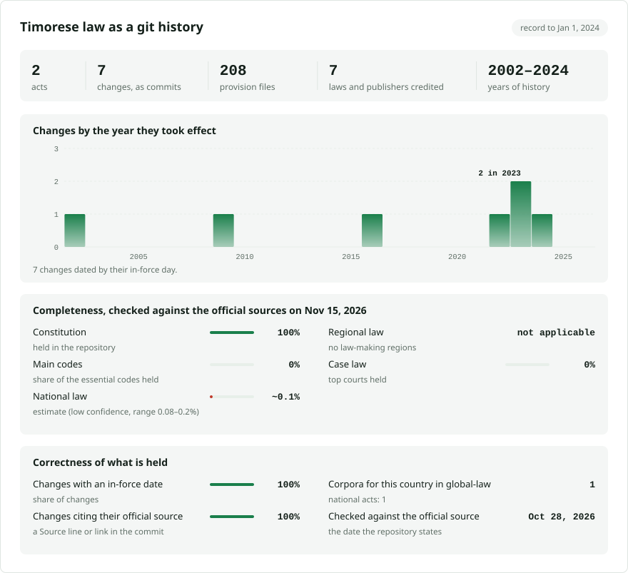

# Timor-Leste: law history in git

[Português](README.md) · **English**

<picture>
<source media="(prefers-color-scheme: dark)" srcset="data/effort-dark.svg">

</picture>

The law of Timor-Leste as a git history: one file per article, one commit per version on the day it took effect, and the act that made each change as the commit's author. `git blame` names the act behind every paragraph; `git log` lists every change to an article; picking a date gives the text in force that day.

Part of [lexifina/global-law](https://github.com/lexifina/global-law), one git history for every country's law: this is Timor-Leste's national law, which global-law reads at `timor-leste/national/acts/`.

**What is in it now:** the Constitution of 2002; the codes, and the laws, decree-laws, Government decrees, resolutions of the National Parliament and of the Government and ministerial diplomas published in Série I of the Jornal da República since 2002, each as published and dated on the day it entered into force under its own rule; and Lei n.º 11/2009 (Divisão Administrativa do Território) in every version to 1 January 2024. The layout is in [`STRUCTURE.md`](STRUCTURE.md); each act's folder has a `README.md` with its publication, entry into force and source PDF.

Each act is a folder, by kind and year, one file per article plus `preambulo.md` and `estrutura.md` (the chapter headings and the order of the files): `leis/2009/11-divisao-administrativa-do-territorio/artigo-007.md` is Article 7 (Município de Baucau) of Lei n.º 11/2009, inserted articles are `artigo-004-A.md`, and the Constitution is in [`constituicao/`](constituicao/) and each code in `codigos/` (for example `codigos/codigo-penal/`).

The text is in Portuguese, as the Jornal da República prints it; Tetum, also an official language, is not here. An English translation is not part of this record.

## Questions as git commands

| Question | Command |
| --- | --- |
| Every change to Article 7 of Lei n.º 11/2009 (Município de Baucau) | `git log -p --word-diff -- leis/2009/11-divisao-administrativa-do-territorio/artigo-007.md` |
| Which act wrote each paragraph of Article 7? | `git blame leis/2009/11-divisao-administrativa-do-territorio/artigo-007.md` |
| Every version of Article 7, with the day each took effect | `git log --format="%h %(trailers:key=In-force,valueonly,separator=) %an" -- leis/2009/11-divisao-administrativa-do-territorio/artigo-007.md` |
| Article 7 as in force on 31 December 2023 | `python tools/em_vigor.py 2023-12-31 leis/2009/11-divisao-administrativa-do-territorio 7` |

**Outside git**, we also host this record publicly, for free:

- **[Ask Claude about Timorese law](https://global-law.lexifina.com/v1/try_claude?country=timor-leste)**: opens Claude with a first question ready.
- **[Ask ChatGPT](https://global-law.lexifina.com/v1/try_chatgpt?country=timor-leste)**: the same question in ChatGPT.
- **[Search Timorese law on our site](https://lexifina.com/law?country=timor-leste&q=liberdade+de+express%C3%A3o)**: a search for "liberdade de expressão" (freedom of expression), with each provision's text and its versions, no account needed.
- **[Developer REST API](https://global-law.lexifina.com/v1/search_law?query=liberdade+de+express%C3%A3o&jurisdiction=timor-leste)**: the same search as JSON, with no key. See the [documentation here](https://lexifina.com/api/global-law).

Both assistants read the record through the free Global law connector (MCP, `https://global-law.lexifina.com/mcp`); the first time, the chat gives you the link that adds it. Ask in Portuguese or in English.

**Host it yourself easily.** All it takes is git and Python, and the tools run on your machine:

```sh
git clone --depth 1 https://github.com/lexifina/global-law && cd global-law
python3 tools/countries.py add timor-leste/national/acts
python3 tools/law.py show 2026-01-01 timor-leste/national/acts/leis/2009/11-divisao-administrativa-do-territorio/artigo-007.md
```

Opened in Claude Code, Cursor, VS Code or Codex, the clone also starts a local MCP server with the same tools ([MCP.md](https://github.com/lexifina/global-law/blob/main/MCP.md)).

## Dates

Each commit is dated at noon, Asia/Dili (UTC+9), on the day the version took effect, and carries it in its `In-force:` trailer, with the law's `Approved:`, `Promulgated:` and `Published:` days:

- the day each law's own words give: the Constitution's Article 170 (20 May 2002), and for Lei n.º 11/2009 and its amending laws the day after publication in the Jornal da República, except Lei n.º 14/2023, which says 1 January 2024;
- Lei n.º 14/2021 entered into force on 8 July 2021 but "produz efeitos a partir do dia 1 de janeiro de 2022": its commit is dated 1 January 2022 and carries `Entered-into-force: 2021-07-08`;
- the republication by Lei n.º 19/2023 already prints the changes Lei n.º 14/2023 makes to Articles 7 and 13; they are held back to 1 January 2024 (`Held-back:` trailers). Ask for a date with `tools/em_vigor.py`, not `git log --before`, which uses your local time zone.

Each change is credited to the law that made it, including changes printed only in its republished annex. Ten articles whose new words both 2023 republications print, though neither law's operative articles name them, are in one labelled commit credited to the Jornal da República, with both laws as `Candidate:`. The committer is always Lexifina.

## How it is checked

- The builder's `check_repo.py` compares every file at every commit with the text read from the official PDF: 7 versions, 405 file checks, 0 mismatches; each full version's words were also found, in order, in a second, independent reading of the PDF (5 of 5). The results are in [`REPRODUCE.md`](REPRODUCE.md).
- The texts are read from the PDFs' own text layers (no OCR); each law's dates are read from its own words and checked against a table, and any difference stops the build.
- Two more builds from the cache gave identical hashes, and `test_repo.py` checks on a clone that blame names the amending laws and the dated tool gives the right text across amendments (11 of 11 passed).
- History is append-only: no merge commits, no rewriting, and every commit's trailers parse.
- [vulnerabilities/](vulnerabilities/README.en.md): possible drafting mistakes in this law, found by global-law's detectors and checked by hand. Not run yet.

## What it does not show

- **Later versions of the other acts.** Apart from Lei n.º 11/2009, each act is here as published; its amendments are here as acts of their own, but not yet applied to the text they amend. Acts whose entry-into-force rule fixes no day (then the tenth working day applies, Lei n.º 1/2002, Article 16), or not yet in force, are held back; decrees of the President of the Republic, despachos and notices are not here.
- **The Constitution as printed in a gazette issue.** The text here is the Portuguese PDF the Ministry of Justice serves with the Jornal; the Tetum text, also official, is not here.
- **Acts published after 26 November 2026**, when the sources were last read.

## Sources

| Source | Kind | Past versions | Notes |
| --- | --- | --- | --- |
| [Jornal da República](https://www.mj.gov.tl/jornal/) (Ministério da Justiça) | Official gazette, born-digital PDFs | yes, each amending law republishes Lei n.º 11/2009 in full | The Série I indexes by kind of act and the gazette issues they link, since 2002 |
| [Constituição da RDTL](https://www.mj.gov.tl/jornal/public/docs/ConstituicaoRDTL_Portugues.pdf), served with the Jornal | Official text, PDF | no, never amended | The Portuguese text of 2002 |

## Licence

See [`LICENSE`](LICENSE). Legislative and regulatory texts and judicial decisions are not protected by copyright (Código do Direito de Autor, Lei n.º 14/2022, Article 15(1)(e)); when quoting, cite the Jornal da República issue (its series, number and date are in each commit's `Published:` and `Source:` trailers). Lexifina's tools and documentation are CC0 1.0.

No AI wrote or edited legal text, and no model runs at build time; the research, the builder and the checks were written by Claude Code with Claude Opus 5.5, and commit messages are generated by code from the gazette text (see [`REPRODUCE.md`](REPRODUCE.md)).

## Visualisations

- [visualisations/](visualisations/README.en.md): charts drawn from this repository. Not drawn yet.

## More

From [lexifina/global-law](https://github.com/lexifina/global-law):

- [FEATURES.md](https://github.com/lexifina/global-law/blob/main/FEATURES.md): every feature, and what every corpus must support (`git blame`, `law.py`, the MCP tools)
- [FAQ.md](https://github.com/lexifina/global-law/blob/main/FAQ.md): questions and answers · [CONTRIBUTING.md](https://github.com/lexifina/global-law/blob/main/CONTRIBUTING.md): proposing changes · [MCP.md](https://github.com/lexifina/global-law/blob/main/MCP.md): the MCP server · [REPRODUCE.md](https://github.com/lexifina/global-law/blob/main/REPRODUCE.md): how it was built · [CHANGELOG.md](https://github.com/lexifina/global-law/blob/main/CHANGELOG.md)
- [FRESHNESS.md](https://github.com/lexifina/global-law/blob/main/FRESHNESS.md): how current each corpus is · [Monitoring](https://github.com/lexifina/global-law/tree/main/monitoring): whether updates are running · [WATCHING.md](https://github.com/lexifina/global-law/blob/main/WATCHING.md): how each official source is watched for changes
- [performance/](https://github.com/lexifina/global-law/tree/main/performance): how fast the tools are, measured
- [visualisations/](https://github.com/lexifina/global-law/tree/main/visualisations): charts and bridges across the world's law
- [Vulnerabilities](https://github.com/lexifina/global-law/tree/main/vulnerabilities): mistakes in legislation as published
