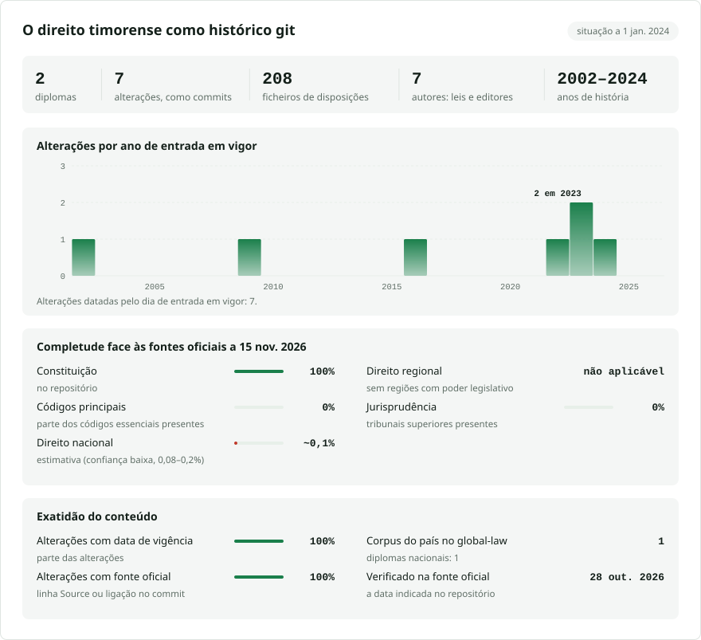

# Timor-Leste: a história do direito em git

**Português** · [English](README.en.md)

<picture>
<source media="(prefers-color-scheme: dark)" srcset="data/pt/effort-dark.svg">

</picture>

O direito de Timor-Leste como uma história git: um ficheiro por artigo, um commit por versão no dia em que entrou em vigor e, como autor do commit, o ato que fez cada alteração. `git blame` indica o ato por detrás de cada parágrafo; `git log` lista todas as alterações a um artigo; escolhendo uma data, obtém-se o texto em vigor nesse dia.

Faz parte de [lexifina/global-law](https://github.com/lexifina/global-law), uma única história git do direito de todos os países: este é o direito nacional de Timor-Leste, que o global-law lê em `timor-leste/national/acts/`.

**O que contém por agora:** a Constituição (Constituição da República Democrática de Timor-Leste, 170 artigos), em vigor desde 20 de maio de 2002 e nunca alterada; e a Lei n.º 11/2009, de 7 de outubro (Divisão Administrativa do Território), em cinco versões: tal como aprovada, em vigor desde 8 de outubro de 2009, e tal como republicada pela Lei n.º 4/2016 (desde 26 de maio de 2016), pela Lei n.º 14/2021 (desde 1 de janeiro de 2022), pela Lei n.º 19/2023 (desde 6 de dezembro de 2023) e pela Lei n.º 14/2023 (desde 1 de janeiro de 2024), agora com 32 artigos. A pasta de cada ato tem um `README.md` que lista as suas versões; [`data/versions.json`](data/versions.json) lista todas as versões com o respetivo PDF de origem e o seu sha256, e [`SOURCES.md`](SOURCES.md) todos os números do jornal oficial lidos.

Cada ato é uma pasta, com um ficheiro por artigo e ainda `preambulo.md` e `estrutura.md` (as epígrafes dos capítulos e a ordem dos ficheiros): `lei-11-2009/artigo-007.md` é o artigo 7.º (Município de Baucau) da Lei n.º 11/2009, os artigos aditados são `artigo-004-A.md`, e a Constituição está em [`constituicao/`](constituicao/).

O texto está em português, tal como o Jornal da República o publica; o tétum, também língua oficial, não está aqui. Não faz parte deste registo nenhuma tradução inglesa.

## Perguntas como comandos git

| Pergunta | Comando |
| --- | --- |
| Todas as alterações ao artigo 7.º da Lei n.º 11/2009 (Município de Baucau) | `git log -p --word-diff -- lei-11-2009/artigo-007.md` |
| Que ato escreveu cada parágrafo do artigo 7.º? | `git blame lei-11-2009/artigo-007.md` |
| Todas as versões do artigo 7.º, com o dia em que cada uma entrou em vigor | `git log --format="%h %(trailers:key=In-force,valueonly,separator=) %an" -- lei-11-2009/artigo-007.md` |
| O artigo 7.º em vigor em 31 de dezembro de 2023 | `python tools/em_vigor.py 2023-12-31 lei-11-2009 7` |

**Fora do git**, também disponibilizamos este registo publicamente e de forma gratuita:

- **[Perguntar ao Claude sobre o direito timorense](https://global-law.lexifina.com/v1/try_claude?country=timor-leste)**: abre o Claude com uma primeira pergunta já preparada.
- **[Perguntar ao ChatGPT](https://global-law.lexifina.com/v1/try_chatgpt?country=timor-leste)**: a mesma pergunta no ChatGPT.
- **[Pesquisar o direito timorense no nosso sítio](https://lexifina.com/law?country=timor-leste&q=liberdade+de+express%C3%A3o)**: uma pesquisa por "liberdade de expressão", com o texto de cada disposição e as suas versões, sem necessidade de conta.
- **[API REST para programadores](https://global-law.lexifina.com/v1/search_law?query=liberdade+de+express%C3%A3o&jurisdiction=timor-leste)**: a mesma pesquisa em JSON, sem chave. Veja a [documentação aqui](https://lexifina.com/api/global-law).

Ambos os assistentes leem o registo através do conector gratuito Global law (MCP, `https://global-law.lexifina.com/mcp`); da primeira vez, a conversa dá-lhe a ligação que o adiciona. Pergunte em português ou em inglês.

**Aloje-o facilmente por conta própria.** Basta ter git e Python, e as ferramentas correm na sua máquina:

```sh
git clone --depth 1 https://github.com/lexifina/global-law && cd global-law
python3 tools/countries.py add timor-leste/national/acts
python3 tools/law.py show 2026-01-01 timor-leste/national/acts/lei-11-2009/artigo-007.md
```

Aberto no Claude Code, no Cursor, no VS Code ou no Codex, o clone inicia também um servidor MCP local com as mesmas ferramentas ([MCP.md](https://github.com/lexifina/global-law/blob/main/MCP.md)).

## Datas

Cada commit tem a data do meio-dia, hora de Asia/Dili (UTC+9), do dia em que a versão entrou em vigor, e indica-a no seu trailer `In-force:`, com os dias de aprovação, promulgação e publicação da lei (`Approved:`, `Promulgated:` e `Published:`):

- o dia que o próprio texto de cada lei indica: o artigo 170.º da Constituição (20 de maio de 2002) e, para a Lei n.º 11/2009 e as suas leis de alteração, o dia seguinte ao da publicação no Jornal da República, exceto a Lei n.º 14/2023, que indica 1 de janeiro de 2024;
- a Lei n.º 14/2021 entrou em vigor em 8 de julho de 2021, mas "produz efeitos a partir do dia 1 de janeiro de 2022": o seu commit tem a data de 1 de janeiro de 2022 e contém `Entered-into-force: 2021-07-08`;
- a republicação pela Lei n.º 19/2023 já imprime as alterações que a Lei n.º 14/2023 faz aos artigos 7.º e 13.º; essas alterações ficam retidas até 1 de janeiro de 2024 (trailers `Held-back:`). Consulte uma data com `tools/em_vigor.py`, não com `git log --before`, que usa o seu fuso horário local.

Cada alteração é atribuída à lei que a fez, incluindo as alterações impressas apenas no anexo de republicação. Dez artigos cuja nova redação é impressa por ambas as republicações de 2023, embora os artigos dispositivos de nenhuma das leis os mencionem, estão num commit identificado, atribuído ao Jornal da República, com ambas as leis como `Candidate:`. O committer é sempre a Lexifina.

## Como é verificado

- O `check_repo.py` do construtor compara cada ficheiro em cada commit com o texto lido do PDF oficial: 7 versões, 405 verificações de ficheiros, 0 divergências; as palavras de cada versão completa foram também encontradas, pela ordem, numa segunda leitura independente do PDF (5 de 5). Os resultados estão em [`REPRODUCE.md`](REPRODUCE.md).
- Os textos são lidos das próprias camadas de texto dos PDF (sem OCR); as datas de cada lei são lidas do seu próprio texto e confrontadas com uma tabela, e qualquer diferença interrompe a construção.
- Mais duas construções a partir da cache deram hashes idênticos, e `test_repo.py` verifica, num clone, que o blame indica as leis de alteração e que a ferramenta por data dá o texto certo ao longo das alterações (11 de 11 aprovados).
- A história só cresce por acréscimo: sem commits de fusão (merge), sem reescrita, e os trailers de todos os commits são legíveis.

## O que não mostra

- **Nenhum outro ato.** Só a Constituição e a Lei n.º 11/2009 estão aqui; as outras leis e decretos do Jornal da República, incluindo os diplomas do Governo que fixam as áreas dos postos administrativos, não estão.
- **A Constituição tal como impressa num número do jornal oficial.** O texto aqui é o PDF em português que o Ministério da Justiça disponibiliza com o Jornal; o texto em tétum, também oficial, não está aqui.
- **Alterações posteriores a 28 de outubro de 2026**, data da última leitura das fontes; a última alteração aqui entrou em vigor em 1 de janeiro de 2024.

## Fontes

| Fonte | Tipo | Versões anteriores | Notas |
| --- | --- | --- | --- |
| [Jornal da República](https://www.mj.gov.tl/jornal/) (Ministério da Justiça) | Jornal oficial, PDF nativamente digitais | sim, cada lei de alteração republica integralmente a Lei n.º 11/2009 | A Lei n.º 11/2009 e as suas quatro leis de alteração, Série I |
| [Constituição da RDTL](https://www.mj.gov.tl/jornal/public/docs/ConstituicaoRDTL_Portugues.pdf), disponibilizada com o Jornal | Texto oficial, PDF | não, nunca alterada | O texto em português de 2002 |

## Licença

Veja [`LICENSE`](LICENSE). Não foram encontradas condições de utilização nem licença no sítio do Jornal da República, e nenhuma é concedida aqui para os textos jurídicos; ao citar, indique o número do Jornal da República (a série, o número e a data constam dos trailers `Published:` e `Source:` de cada commit). As ferramentas e a documentação estão sob a licença MIT.

Nenhuma IA escreveu ou editou texto jurídico, e nenhum modelo é executado durante a construção; a investigação, o construtor e as verificações foram escritos pelo Claude Code com o Claude Opus 5.5, e as mensagens de commit são geradas por código a partir do texto do jornal oficial (veja [`REPRODUCE.md`](REPRODUCE.md)).

Esta é uma tradução da versão inglesa ([README.en.md](README.en.md)); em caso de divergência, prevalece a versão inglesa.

## Mais informação

Do repositório [lexifina/global-law](https://github.com/lexifina/global-law) (páginas em inglês):

- [FEATURES.md](https://github.com/lexifina/global-law/blob/main/FEATURES.md): todas as funcionalidades e o que cada corpus tem de suportar (`git blame`, `law.py`, ferramentas MCP)
- [FAQ.md](https://github.com/lexifina/global-law/blob/main/FAQ.md): perguntas e respostas · [CONTRIBUTING.md](https://github.com/lexifina/global-law/blob/main/CONTRIBUTING.md): propor alterações · [MCP.md](https://github.com/lexifina/global-law/blob/main/MCP.md): servidor MCP · [REPRODUCE.md](https://github.com/lexifina/global-law/blob/main/REPRODUCE.md): como foi construído · [CHANGELOG.md](https://github.com/lexifina/global-law/blob/main/CHANGELOG.md)
- [FRESHNESS.md](https://github.com/lexifina/global-law/blob/main/FRESHNESS.md): quão atualizado está cada corpus · [Monitorização](https://github.com/lexifina/global-law/tree/main/monitoring): se as atualizações estão a funcionar · [WATCHING.md](https://github.com/lexifina/global-law/blob/main/WATCHING.md): como cada fonte oficial é vigiada para detetar alterações
- [performance/](https://github.com/lexifina/global-law/tree/main/performance): a rapidez das ferramentas, medida
- [visualisations/](https://github.com/lexifina/global-law/tree/main/visualisations): gráficos e ligações através do direito de todo o mundo
- [Vulnerabilidades](https://github.com/lexifina/global-law/tree/main/vulnerabilities): erros nos diplomas tal como foram publicados
